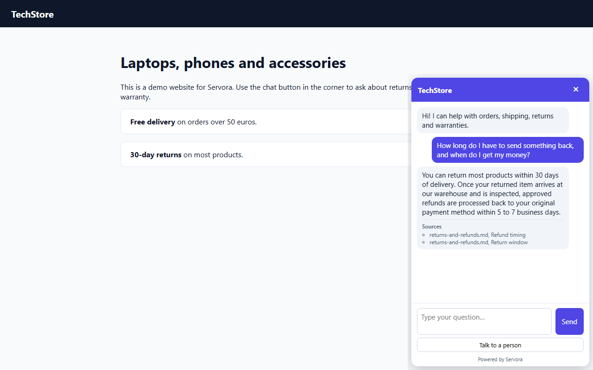
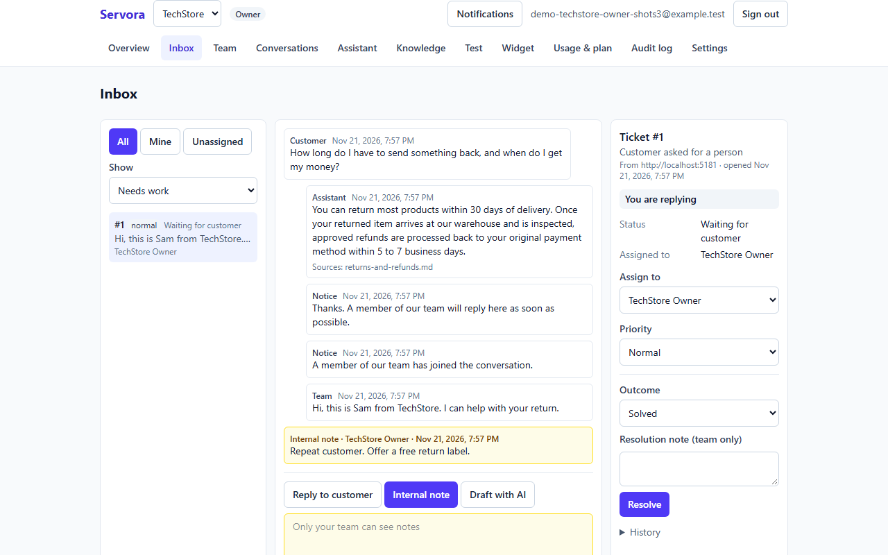
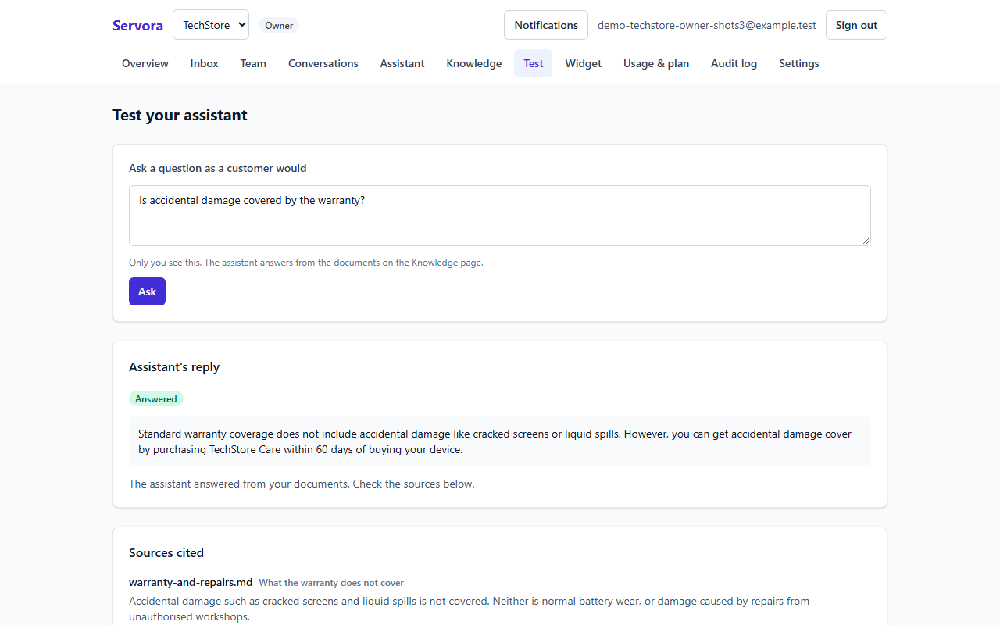
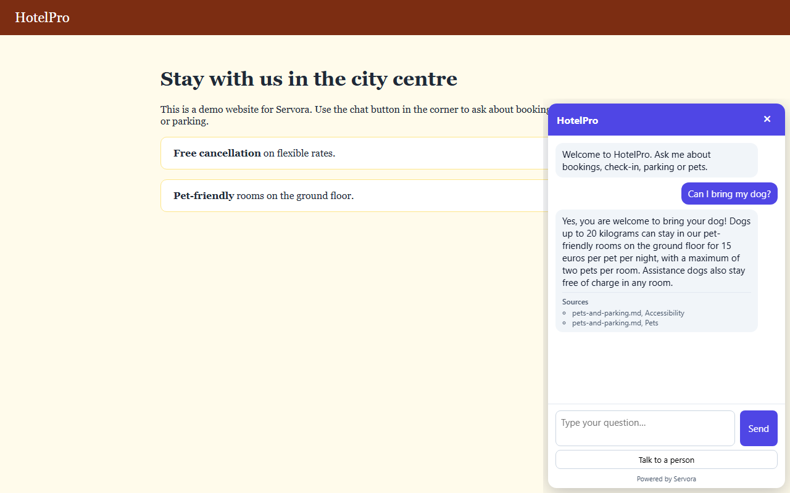
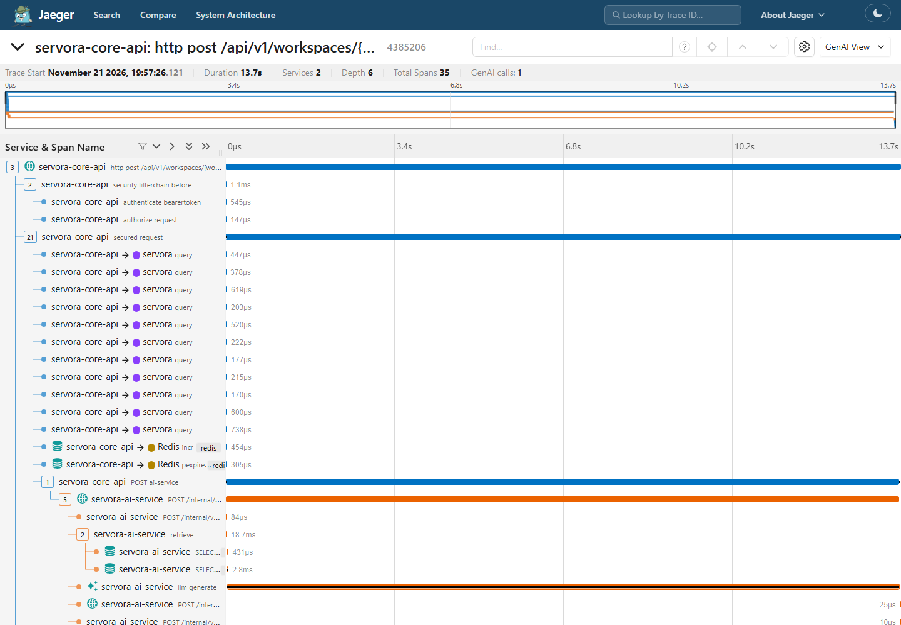
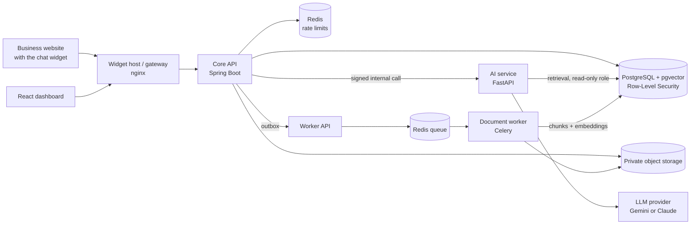

# Servora

**A multi-tenant AI customer-support platform.** Each business gets an isolated workspace: an assistant that answers customers from that business's own documents and cites them, an embeddable chat widget, and an inbox where people take over when the assistant should not answer.



## Highlights

- **Answers it can back up, hands over when it can't.** Answers come only from the business's documents, with citations the backend checks against what was actually retrieved. Measured against a live model (Gemini 3.5 Flash-Lite) on 50 questions: 87% of answerable questions answered, every answer from the right document, none of the 10 unanswerable questions answered, and every request for a person handed over ([evaluation report](docs/ai/evaluation-report.md)).
- **Tenant isolation enforced twice.** Every query is scoped by the application, and PostgreSQL Row-Level Security (forced, with unprivileged runtime roles) blocks other tenants' rows even if a query forgot. A test matrix calls every endpoint across tenants ([evidence](docs/security/tenant-isolation.md)).
- **AI-to-human handoff without races.** A person can take over at any moment, and an AI reply that was still being generated is never delivered afterwards, tested over 24 rounds on every run.
- **Production-minded.** Hardened containers on an internal network, migrations run apart from the API, image and dependency scanning, backups with a recorded restore drill, metrics, JSON logs and OpenTelemetry traces across services.
- **Tested end to end.** 190 core API tests, most of them through the real HTTP API against real PostgreSQL and Redis, Python and frontend unit tests, a Playwright suite running the full demonstration script with an accessibility check (WCAG 2.1 AA), and a load test (P95 15 ms at 100 virtual users on the non-AI endpoints).

| | |
|---|---|
|  |  |
| **Inbox:** a person takes over; internal notes never reach the customer | **Playground:** see what the assistant would answer, and why |
|  |  |
| **Another tenant:** same platform, only its own documents | **Tracing:** one question across the API, AI service, database and model |

## How it works



- **Core API** (Java 25, Spring Boot 4) is the system of record: identity, tenancy, roles, conversations, tickets, usage, audit. Only it decides who may see what.
- **AI service** (Python, FastAPI) retrieves passages for one tenant, decides whether the evidence is good enough, asks the model for a structured answer, and checks that every citation is a passage it retrieved. It has no say over permissions or ticket state.
- **Document worker** (Python, Celery) extracts, chunks and embeds uploads in the background; a transactional outbox hands jobs over reliably.
- **Dashboard** (React 19, TypeScript) and **widget** (dependency-free TypeScript in an iframe, with a small loader script).

The reasons behind each choice are recorded as [architecture decision records](docs/architecture/adr/README.md). More: [system overview](docs/architecture/system-overview.md), [version matrix](docs/architecture/version-matrix.md).

## Try it

With Docker and Node.js installed, after copying `.env.example` to `.env` and filling in its secrets:

```bash
SERVORA_PROD_MAIL_LOG_LINKS=true docker compose -p servora-prod -f docker-compose.yml -f compose.prod.yml up -d --build --wait
node scripts/seed-demo.mjs --compose-project servora-prod --api http://localhost:8000
node apps/widget/demo/serve.mjs
```

This seeds two demo businesses, TechStore and HotelPro, with documents, assistants, widgets and agents, and prints where to sign in and chat. The walkthrough is in [docs/demo.md](docs/demo.md); the [user guide](docs/user-guide.md) covers the dashboard. Out of the box the assistant uses a free built-in test model; set a Gemini or Anthropic key in `.env` for real answers.

## Status

**The MVP is complete (milestones M1 to M7).** Registration and workspaces with roles; documents indexed in the background; an assistant with citations, fallbacks and handoff; a widget restricted to each business's websites; a team inbox with takeover, internal notes and AI drafts; analytics, usage limits and an audit log; retention, deletion and export; platform administration. Progress and the post-MVP backlog are in [docs/milestones.md](docs/milestones.md); known limits are [below](#limitations).

## Prerequisites

| Tool | Version |
|---|---|
| Docker Engine and Compose | 29.x and v5.x |
| Java (JDK) | 25 |
| Node.js | 24.x LTS |

Maven is provided by the Maven Wrapper in `services/core-api`. Python runs inside the worker container, so it is not needed on the host.

## Local setup

### 1. Configure

```bash
cp .env.example .env
```

Edit `.env`:

- Set the three `SERVORA_POSTGRES_*_PASSWORD` values to different local passwords.
- Set `SERVORA_STORAGE_ACCESS_KEY` and `SERVORA_STORAGE_SECRET_KEY` to local values of your choice.
- Set `SERVORA_JWT_SECRET`, `SERVORA_INTERNAL_TOKEN_SECRET` and `SERVORA_WIDGET_TOKEN_SECRET` to three different outputs of `openssl rand -base64 48`.

`.env` is git-ignored. Docker Compose and the core API both read it.

### 2. Start the infrastructure, worker and AI service

```bash
docker compose up -d --build --wait
```

This starts PostgreSQL, Redis, the storage emulator, the document worker and the AI service. The first build downloads PyTorch and the embedding model and produces two images of about 1.7 GB each, which share most of their layers, so allow several minutes.

To get real answers instead of the built-in test model, set either `SERVORA_LLM_PROVIDER=gemini` and `SERVORA_GEMINI_API_KEY` (free tier, from <https://aistudio.google.com/apikey>), or `SERVORA_LLM_PROVIDER=anthropic` and `SERVORA_ANTHROPIC_API_KEY` (paid), in `.env`, then run `docker compose up -d ai-service`. On Gemini's free tier Google may use what is sent to improve its products, so use demo data only.

The first start also creates the unprivileged database roles `servora_app`, `servora_worker` and `servora_ai`. If your database volume predates M3, the newer roles are missing; recreate the volume with `docker compose down -v` (this deletes local data) and start again.

### 3. Start the core API

```bash
cd services/core-api && ./mvnw spring-boot:run
```

On Windows PowerShell use `.\mvnw.cmd spring-boot:run`. The API applies database migrations on startup and listens on <http://localhost:8080>. Health: <http://localhost:8080/readyz>. Metrics: <http://localhost:8081/actuator/prometheus> (management port). API reference: <http://localhost:8080/swagger-ui.html>.

### 4. Start the dashboard

```bash
cd apps/web && npm install && npm run dev
```

Open <http://localhost:5173>. The dev server proxies `/api` to the core API, so the browser sees one origin.

### 4a. Try the chat widget

```bash
cd apps/widget && npm install && npm run dev
```

In a second terminal, `npm run demo` in `apps/widget` serves two demo websites: TechStore on <http://localhost:5181> and HotelPro on <http://localhost:5182>. For each workspace, add the demo site's address on the Widget page, upload the matching files from `services/ai-service/evaluation/fixtures` on the Knowledge page, then open the site with `?key=` and the widget key. Details: [apps/widget/README.md](apps/widget/README.md).

### 5. Verification and invitation emails

No email provider is connected yet. With `SERVORA_MAIL_LOG_LINKS=true` (the template default, for local development only) the core API writes each verification and invitation link to its log:

```text
DEV MAIL verification link: http://localhost:5173/verify-email#token=...
```

Open the link in the browser to continue. These links contain secret tokens, so never enable this setting outside local development.

### 6. Platform administration (optional)

Platform admins are not created by the application. To make an existing, verified user one, run this against the local database. It adds a row to `platform_admins`, which the runtime role cannot do itself:

```bash
docker compose exec postgres psql -U servora_owner -d servora -c "INSERT INTO platform_admins (user_id) SELECT id FROM users WHERE email = 'you@example.test';"
```

Replace the email, and the user and database names if you changed them in `.env`. Sign in again and a **Platform admin** link appears on the workspace list.

### 7. Run everything in containers (production profile)

```bash
docker compose -p servora-prod -f docker-compose.yml -f compose.prod.yml up -d --build --wait
```

The dashboard and API on <http://localhost:8000> and the widget host on <http://localhost:8001>, with migrations run by a separate container, no published database or Redis ports, and hardened containers. See [docs/operations/production.md](docs/operations/production.md); backups in [docs/operations/backup-and-restore.md](docs/operations/backup-and-restore.md).

### 8. Metrics and traces (optional)

```bash
docker compose -f docker-compose.yml -f compose.observability.yml up -d
```

Prometheus with alert rules on <http://localhost:9090> and Jaeger on <http://localhost:16686>, both on 127.0.0.1 only. To send the host API's traces to Jaeger, start it with `MANAGEMENT_OPENTELEMETRY_TRACING_EXPORT_OTLP_ENDPOINT=http://localhost:4318/v1/traces`. Every response's `X-Request-Id` is its trace ID. See [docs/operations/observability.md](docs/operations/observability.md).

## Tests

```bash
cd services/core-api && ./mvnw verify
```

Runs unit tests and integration tests. The integration tests need Docker: they start PostgreSQL through Testcontainers, connect as the unprivileged runtime role, and exercise the real HTTP API with Row-Level Security enabled.

```bash
cd apps/web && npm run lint && npm run typecheck && npm test
```

Browser tests of the MVP demonstration script, with an accessibility check (axe, WCAG 2.1 AA), run against the real local stack with Playwright: see [tests/e2e/README.md](tests/e2e/README.md). The answer evaluation is in [docs/ai/evaluation-report.md](docs/ai/evaluation-report.md). The load test and its results are in [docs/testing/load-test.md](docs/testing/load-test.md).

The Python services' tests are described in [workers/document-worker/README.md](workers/document-worker/README.md) and [services/ai-service/README.md](services/ai-service/README.md).

## Stopping

```bash
docker compose down
```

Add `-v` to also delete the database volume.

## Repository layout

```text
apps/web                  React dashboard
apps/widget               Chat widget (iframe and loader) and two demo websites
services/core-api         Spring Boot modular monolith
services/ai-service       FastAPI RAG service
workers/document-worker   Celery ingestion worker and its enqueue endpoint
infrastructure            Database bootstrap, monitoring, backup and CI scripts
scripts                   Demo seed script
tests/e2e                 Playwright browser suite and the README screenshot script
tests/evaluation          Answer evaluation against a live model
tests/load                k6 load test
docs                      Architecture, database, API, security, AI, operations and user documentation
```

## Documentation

- [Case study](docs/case-study.md): the problem, key decisions and results in one page
- [Running the demo](docs/demo.md) and the [user guide](docs/user-guide.md)
- [Implementation plan](docs/implementation-plan.md) and [milestone checklist](docs/milestones.md)
- [Architecture](docs/architecture/system-overview.md)
- [Database and tenant ownership](docs/database/erd.md)
- [API](docs/api/README.md)
- [Ingestion, chunking and embeddings](docs/ai/README.md), [retrieval baseline](docs/ai/evaluation-baseline.md) and [answer evaluation](docs/ai/evaluation-report.md)
- Operations: [production profile](docs/operations/production.md), [backup and restore](docs/operations/backup-and-restore.md), [observability](docs/operations/observability.md)
- [Threat model](docs/security/threat-model.md) and [tenant isolation test evidence](docs/security/tenant-isolation.md)
- [Contributing and conventions](CONTRIBUTING.md)

## Demo credentials policy

No credentials are committed. There are no built-in accounts: register your own locally. `.env.example` holds placeholders only.

## Limitations

- **No email delivery.** Links are written to the development log.
- **In development the API runs migrations at startup** and holds the database owner's password. The production profile separates them ([docs/operations/production.md](docs/operations/production.md)).
- **No TLS in the production profile.** It binds to 127.0.0.1; put a TLS-terminating proxy in front before exposing it.
- **Answer quality is measured on a small set only.** 50 questions over 6 demo documents with one model (Gemini 3.5 Flash-Lite): 87 percent of answerable questions answered, all from the right document, no unanswerable question answered ([docs/ai/evaluation-report.md](docs/ai/evaluation-report.md)). Groundedness was reviewed by an AI assistant, not by a person. The Anthropic integration has been tested against a stub only.
- **The evidence threshold is a trade-off, not a solved problem.** In the baseline no threshold separated answerable from unanswerable questions cleanly, and everyday wording far from a document's terms is handed to a person.
- **With a real model, questions and retrieved passages are sent to Google or Anthropic.**
- **Each customer question is answered on its own**, without the earlier turns of the conversation.
- **A chat lasts at most two hours.** When the session expires the widget starts a new conversation; visitors cannot resume a chat on another device.
- **Answers are shown when complete**, not word by word, so they can be checked before the customer sees them.
- **Agent replies reach the customer within about five seconds**: the widget checks for them rather than receiving a push.
- **Notifications are in the dashboard only**, not by email.
- **Escalation rules are built in**, and the list of risky terms is English only.
- **No OCR.** Scanned PDFs without a text layer fail as empty. Encrypted PDFs are refused.
- **No malware scanning of uploads.**
- **Plan limits are soft** by up to the number of requests running at the same moment, and there is no billing: an operator changes plans.
- **Estimated cost is only as good as the configured prices**, and shows as not configured until you set them.
- **Analytics use UTC days**, not the workspace's timezone.
- **Deletion is per conversation.** Deleting a whole workspace, and removing stored document files when conversations expire, are not built.
- **Workspace logos are a URL**, not an upload.
- **Platform administration has a table but no features** until M6.
- This is an engineering project, not legal advice; privacy and consumer-protection requirements need review before any real customer data is used.
- **Not deployed anywhere.** The production profile runs on one machine behind 127.0.0.1; there is no hosted instance, TLS or domain.
- **Accessibility is checked automatically only** (axe, WCAG 2.1 AA, serious and critical issues), not with a screen reader or by a person.
