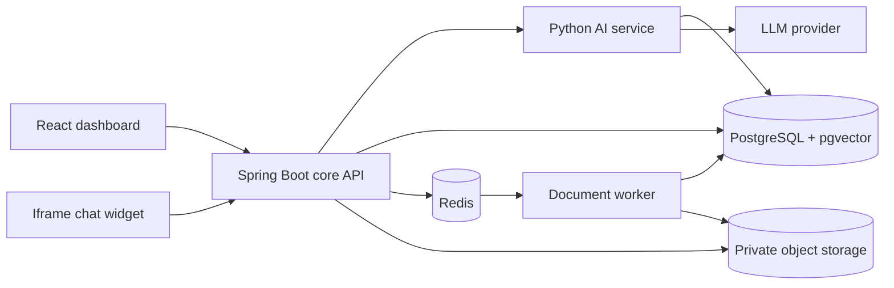

# Servora

Servora is a multi-tenant AI customer-support platform. Each business gets an isolated workspace with its own assistant, knowledge base, embeddable chat widget, conversations, tickets and team. The assistant answers from that business's approved documents, cites its sources, and hands off to a human agent when the evidence is not good enough.

## Status

**Milestones M1 to M6 are implemented.** You can register, create workspaces, invite members with roles, configure the assistant and widget, and upload PDF, TXT and Markdown documents that are stored privately and indexed in the background. Customers chat with the assistant through a widget on the workspace's own website: it answers from that workspace's documents with citations, gives a fallback message instead of guessing, and hands the conversation to a person when the customer asks or the assistant cannot help. The team works from an inbox: tickets are assigned, a person takes over the conversation, replies, keeps internal notes, can ask the assistant for a draft, and resolves the ticket, after which the customer can rate it. Owners and admins see an Overview of conversations, escalations and response times, usage against the plan's monthly limits, and an audit log; owners can set a retention period, delete a conversation and export the workspace's data. Platform operators can suspend workspaces and change plans. Tenant isolation is enforced by the application and by PostgreSQL Row-Level Security.

Out of the box the assistant uses a built-in test model that only quotes the best matching passage and costs nothing. Real answers need a Google Gemini key (free tier available) or an Anthropic key (step 2 below).

Not built yet: the hardening and release work of M7. See [docs/milestones.md](docs/milestones.md).

## Architecture



Today the dashboard, core API, document worker, PostgreSQL, Redis and object storage are in use. The AI service and the widget are not built yet.

- **Core API** is the system of record for identity, tenancy, authorization, conversations, tickets, usage and audit.
- **AI service** will handle retrieval, prompt assembly, generation and evaluation. It holds no authority over permissions or ticket state.
- **Document worker** extracts, chunks, embeds and indexes uploaded documents asynchronously.
- **Tenant isolation** uses a shared schema with `tenant_id`, tenant-aware foreign keys and PostgreSQL Row-Level Security.

More detail: [system overview](docs/architecture/system-overview.md), [decision records](docs/architecture/adr/README.md), [version matrix](docs/architecture/version-matrix.md).

## Prerequisites

| Tool | Version |
|---|---|
| Docker Engine and Compose | 29.x and v5.x |
| Java (JDK) | 25 |
| Node.js | 24.x LTS |

Maven is provided by the Maven Wrapper in `services/core-api`. Python runs inside the worker container, so it is not needed on the host.

## Local setup

### 1. Configure

```bash
cp .env.example .env
```

Edit `.env`:

- Set the three `SERVORA_POSTGRES_*_PASSWORD` values to different local passwords.
- Set `SERVORA_STORAGE_ACCESS_KEY` and `SERVORA_STORAGE_SECRET_KEY` to local values of your choice.
- Set `SERVORA_JWT_SECRET`, `SERVORA_INTERNAL_TOKEN_SECRET` and `SERVORA_WIDGET_TOKEN_SECRET` to three different outputs of `openssl rand -base64 48`.

`.env` is git-ignored. Docker Compose and the core API both read it.

### 2. Start the infrastructure, worker and AI service

```bash
docker compose up -d --build --wait
```

This starts PostgreSQL, Redis, the storage emulator, the document worker and the AI service. The first build downloads PyTorch and the embedding model and produces two images of about 1.7 GB each, which share most of their layers, so allow several minutes.

To get real answers instead of the built-in test model, set either `SERVORA_LLM_PROVIDER=gemini` and `SERVORA_GEMINI_API_KEY` (free tier, from <https://aistudio.google.com/apikey>), or `SERVORA_LLM_PROVIDER=anthropic` and `SERVORA_ANTHROPIC_API_KEY` (paid), in `.env`, then run `docker compose up -d ai-service`. On Gemini's free tier Google may use what is sent to improve its products, so use demo data only.

The first start also creates the unprivileged database roles `servora_app`, `servora_worker` and `servora_ai`. If your database volume predates M3, the newer roles are missing; recreate the volume with `docker compose down -v` (this deletes local data) and start again.

### 3. Start the core API

```bash
cd services/core-api && ./mvnw spring-boot:run
```

On Windows PowerShell use `.\mvnw.cmd spring-boot:run`. The API applies database migrations on startup and listens on <http://localhost:8080>. Health: <http://localhost:8080/actuator/health>. API reference: <http://localhost:8080/swagger-ui.html>.

### 4. Start the dashboard

```bash
cd apps/web && npm install && npm run dev
```

Open <http://localhost:5173>. The dev server proxies `/api` to the core API, so the browser sees one origin.

### 4a. Try the chat widget

```bash
cd apps/widget && npm install && npm run dev
```

In a second terminal, `npm run demo` in `apps/widget` serves two demo websites: TechStore on <http://localhost:5181> and HotelPro on <http://localhost:5182>. For each workspace, add the demo site's address on the Widget page, upload the matching files from `services/ai-service/evaluation/fixtures` on the Knowledge page, then open the site with `?key=` and the widget key. Details: [apps/widget/README.md](apps/widget/README.md).

### 5. Verification and invitation emails

No email provider is connected yet. With `SERVORA_MAIL_LOG_LINKS=true` (the template default, for local development only) the core API writes each verification and invitation link to its log:

```text
DEV MAIL verification link: http://localhost:5173/verify-email#token=...
```

Open the link in the browser to continue. These links contain secret tokens, so never enable this setting outside local development.

### 6. Platform administration (optional)

Platform admins are not created by the application. To make an existing, verified user one, run this against the local database. It adds a row to `platform_admins`, which the runtime role cannot do itself:

```bash
docker compose exec postgres psql -U servora_owner -d servora -c "INSERT INTO platform_admins (user_id) SELECT id FROM users WHERE email = 'you@example.test';"
```

Replace the email, and the user and database names if you changed them in `.env`. Sign in again and a **Platform admin** link appears on the workspace list.

## Tests

```bash
cd services/core-api && ./mvnw verify
```

Runs unit tests and integration tests. The integration tests need Docker: they start PostgreSQL through Testcontainers, connect as the unprivileged runtime role, and exercise the real HTTP API with Row-Level Security enabled.

```bash
cd apps/web && npm run lint && npm run typecheck && npm test
```

The Python services' tests are described in [workers/document-worker/README.md](workers/document-worker/README.md) and [services/ai-service/README.md](services/ai-service/README.md).

## Stopping

```bash
docker compose down
```

Add `-v` to also delete the database volume.

## Repository layout

```text
apps/web                  React dashboard
apps/widget               Chat widget (iframe and loader) and two demo websites
services/core-api         Spring Boot modular monolith
services/ai-service       FastAPI RAG service
workers/document-worker   Celery ingestion worker and its enqueue endpoint
infrastructure            Database bootstrap, Docker and monitoring assets
docs                      Architecture, database, API, security and AI documentation
```

## Documentation

- [Implementation plan](docs/implementation-plan.md) and [milestone checklist](docs/milestones.md)
- [Architecture](docs/architecture/system-overview.md)
- [Database and tenant ownership](docs/database/erd.md)
- [API](docs/api/README.md)
- [Ingestion, chunking and embeddings](docs/ai/README.md)
- [Threat model](docs/security/threat-model.md) and [tenant isolation test evidence](docs/security/tenant-isolation.md)
- [Contributing and conventions](CONTRIBUTING.md)

## Demo credentials policy

No credentials are committed. There are no built-in accounts: register your own locally. `.env.example` holds placeholders only.

## Limitations

- **No email delivery.** Links are written to the development log.
- **The API runs migrations at startup** and therefore holds the database owner's credentials. Separating migration from runtime is part of M7.
- **The API and dashboard are not containerised yet.** They run on the host; the infrastructure, worker and AI service run in Compose.
- **Answer quality is unmeasured.** Retrieval has a first baseline on 40 questions ([docs/ai/evaluation-baseline.md](docs/ai/evaluation-baseline.md)); answers from the real model have not been evaluated, the Gemini integration was checked once against the live API, and the Anthropic integration has been tested against a stub only.
- **The evidence threshold is a trade-off, not a solved problem.** In the baseline no threshold separated answerable from unanswerable questions cleanly.
- **With a real model, questions and retrieved passages are sent to Google or Anthropic.**
- **Each customer question is answered on its own**, without the earlier turns of the conversation.
- **A chat lasts at most two hours.** When the session expires the widget starts a new conversation; visitors cannot resume a chat on another device.
- **Answers are shown when complete**, not word by word, so they can be checked before the customer sees them.
- **Agent replies reach the customer within about five seconds**: the widget checks for them rather than receiving a push.
- **Notifications are in the dashboard only**, not by email.
- **Escalation rules are built in**, and the list of risky terms is English only.
- **No OCR.** Scanned PDFs without a text layer fail as empty. Encrypted PDFs are refused.
- **No malware scanning of uploads.**
- **Plan limits are soft** by up to the number of requests running at the same moment, and there is no billing: an operator changes plans.
- **Estimated cost is only as good as the configured prices**, and shows as not configured until you set them.
- **Analytics use UTC days**, not the workspace's timezone.
- **Deletion is per conversation.** Deleting a whole workspace, and removing stored document files when conversations expire, are not built.
- **No browser end-to-end test suite yet.** The flows, including both demo websites, were checked by hand in a browser; Playwright is planned for M7.
- **Workspace logos are a URL**, not an upload.
- **Platform administration has a table but no features** until M6.
- This is an engineering project, not legal advice; privacy and consumer-protection requirements need review before any real customer data is used.
