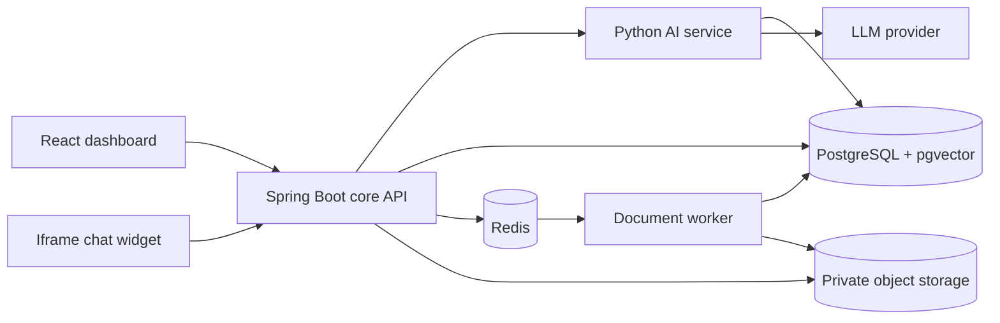

# Servora

Servora is a multi-tenant AI customer-support platform. Each business gets an isolated workspace with its own assistant, knowledge base, embeddable chat widget, conversations, tickets and team. The assistant answers from that business's approved documents, cites its sources, and hands off to a human agent when the evidence is not good enough.

## Status

**Milestones M1 and M2 are implemented.** You can register, create workspaces, invite members with roles, configure the assistant and widget, and upload PDF, TXT and Markdown documents that are stored privately and indexed in the background. Tenant isolation is enforced by the application and by PostgreSQL Row-Level Security.

Not built yet: answering questions from the knowledge base, the chat widget, conversations, tickets and analytics. Uploaded documents are indexed but nothing reads the index until M3. See [docs/milestones.md](docs/milestones.md).

## Architecture



Today the dashboard, core API, document worker, PostgreSQL, Redis and object storage are in use. The AI service and the widget are not built yet.

- **Core API** is the system of record for identity, tenancy, authorization, conversations, tickets, usage and audit.
- **AI service** will handle retrieval, prompt assembly, generation and evaluation. It holds no authority over permissions or ticket state.
- **Document worker** extracts, chunks, embeds and indexes uploaded documents asynchronously.
- **Tenant isolation** uses a shared schema with `tenant_id`, tenant-aware foreign keys and PostgreSQL Row-Level Security.

More detail: [system overview](docs/architecture/system-overview.md), [decision records](docs/architecture/adr/README.md), [version matrix](docs/architecture/version-matrix.md).

## Prerequisites

| Tool | Version |
|---|---|
| Docker Engine and Compose | 29.x and v5.x |
| Java (JDK) | 25 |
| Node.js | 24.x LTS |

Maven is provided by the Maven Wrapper in `services/core-api`. Python runs inside the worker container, so it is not needed on the host.

## Local setup

### 1. Configure

```bash
cp .env.example .env
```

Edit `.env`:

- Set the three `SERVORA_POSTGRES_*_PASSWORD` values to different local passwords.
- Set `SERVORA_STORAGE_ACCESS_KEY` and `SERVORA_STORAGE_SECRET_KEY` to local values of your choice.
- Set `SERVORA_JWT_SECRET` and `SERVORA_INTERNAL_TOKEN_SECRET` to two different outputs of `openssl rand -base64 48`.

`.env` is git-ignored. Docker Compose and the core API both read it.

### 2. Start the infrastructure and worker

```bash
docker compose up -d --build --wait
```

This starts PostgreSQL, Redis, the storage emulator and the document worker. The first build downloads PyTorch and the embedding model and produces an image of about 1.7 GB, so allow several minutes.

The first start also creates the unprivileged database roles `servora_app` and `servora_worker`. If your database volume predates M2, the worker role is missing; recreate the volume with `docker compose down -v` (this deletes local data) and start again.

### 3. Start the core API

```bash
cd services/core-api && ./mvnw spring-boot:run
```

On Windows PowerShell use `.\mvnw.cmd spring-boot:run`. The API applies database migrations on startup and listens on <http://localhost:8080>. Health: <http://localhost:8080/actuator/health>. API reference: <http://localhost:8080/swagger-ui.html>.

### 4. Start the dashboard

```bash
cd apps/web && npm install && npm run dev
```

Open <http://localhost:5173>. The dev server proxies `/api` to the core API, so the browser sees one origin.

### 5. Verification and invitation emails

No email provider is connected yet. With `SERVORA_MAIL_LOG_LINKS=true` (the template default, for local development only) the core API writes each verification and invitation link to its log:

```text
DEV MAIL verification link: http://localhost:5173/verify-email#token=...
```

Open the link in the browser to continue. These links contain secret tokens, so never enable this setting outside local development.

## Tests

```bash
cd services/core-api && ./mvnw verify
```

Runs unit tests and integration tests. The integration tests need Docker: they start PostgreSQL through Testcontainers, connect as the unprivileged runtime role, and exercise the real HTTP API with Row-Level Security enabled.

```bash
cd apps/web && npm run lint && npm run typecheck && npm test
```

The document worker's tests are described in [workers/document-worker/README.md](workers/document-worker/README.md).

## Stopping

```bash
docker compose down
```

Add `-v` to also delete the database volume.

## Repository layout

```text
apps/web                  React dashboard
apps/widget               Iframe customer widget and loader (M4)
services/core-api         Spring Boot modular monolith
services/ai-service       FastAPI RAG service (M3)
workers/document-worker   Celery ingestion worker and its enqueue endpoint
infrastructure            Database bootstrap, Docker and monitoring assets
docs                      Architecture, database, API, security and AI documentation
```

## Documentation

- [Implementation plan](docs/implementation-plan.md) and [milestone checklist](docs/milestones.md)
- [Architecture](docs/architecture/system-overview.md)
- [Database and tenant ownership](docs/database/erd.md)
- [API](docs/api/README.md)
- [Ingestion, chunking and embeddings](docs/ai/README.md)
- [Threat model](docs/security/threat-model.md) and [tenant isolation test evidence](docs/security/tenant-isolation.md)
- [Contributing and conventions](CONTRIBUTING.md)

## Demo credentials policy

No credentials are committed. There are no built-in accounts: register your own locally. `.env.example` holds placeholders only.

## Limitations

- **No email delivery.** Links are written to the development log.
- **Login rate limiting is in memory**, so it applies per API instance and resets on restart.
- **The API runs migrations at startup** and therefore holds the database owner's credentials. Separating migration from runtime is part of M7.
- **The API and dashboard are not containerised yet.** They run on the host; the infrastructure and the worker run in Compose.
- **Indexed documents are not used yet.** Retrieval and answering arrive in M3, so chunk size, overlap and the embedding model are unevaluated.
- **No OCR.** Scanned PDFs without a text layer fail as empty. Encrypted PDFs are refused.
- **No malware scanning of uploads.**
- **The upload rate limit is in memory**, like the login limiter.
- **No browser end-to-end test suite yet.** The flows were checked by hand in a browser; Playwright arrives with later milestones.
- **Workspace logos are a URL**, not an upload.
- **Platform administration has a table but no features** until M6.
- The LLM provider is not chosen yet ([ADR-013](docs/architecture/adr/0013-llm-provider-behind-an-adapter.md)). It is needed for M3.
- This is an engineering project, not legal advice; privacy and consumer-protection requirements need review before any real customer data is used.
