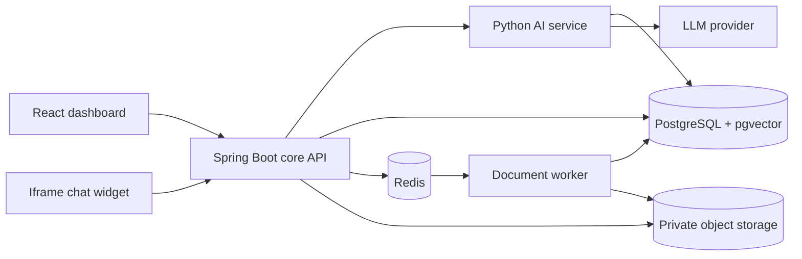

# Servora

Servora is a multi-tenant AI customer-support platform. Each business gets an isolated workspace with its own assistant, knowledge base, embeddable chat widget, conversations, tickets and team. The assistant answers from that business's approved documents, cites its sources, and hands off to a human agent when the evidence is not good enough.

## Status

**Milestone M0 (architecture baseline) is in place.** The repository currently contains documentation, decisions and a local infrastructure Compose file. No application code exists yet. See [docs/milestones.md](docs/milestones.md) for progress.

## Architecture



- **Core API** is the system of record for identity, tenancy, authorization, conversations, tickets, usage and audit.
- **AI service** handles retrieval, prompt assembly, generation and evaluation. It holds no authority over permissions or ticket state.
- **Document worker** extracts, chunks, embeds and indexes uploaded documents asynchronously.
- **Tenant isolation** uses a shared schema with `tenant_id`, tenant-aware foreign keys and PostgreSQL Row-Level Security.

More detail: [system overview](docs/architecture/system-overview.md), [decision records](docs/architecture/adr/README.md), [version matrix](docs/architecture/version-matrix.md).

## Prerequisites

| Tool | Version |
|---|---|
| Docker Engine and Compose | 29.x and v5.x |
| Java | 25 (from M1) |
| Node.js | 24.x LTS (from M1) |

Maven is provided by the Maven Wrapper from M1. Python runs inside containers.

## Local setup

```bash
cp .env.example .env
```

Edit `.env` and replace the placeholder password, then:

```bash
docker compose up -d --wait
```

Check that pgvector is available:

```bash
docker compose exec postgres psql -U servora_owner -d servora -c "CREATE EXTENSION IF NOT EXISTS vector; SELECT extversion FROM pg_extension WHERE extname = 'vector';"
```

Stop the stack, keeping data:

```bash
docker compose down
```

Add `-v` to also delete the database volume.

## Repository layout

```text
apps/web                  React dashboard (M1)
apps/widget               Iframe customer widget and loader (M4)
services/core-api         Spring Boot modular monolith (M1)
services/ai-service       FastAPI RAG service (M3)
workers/document-worker   Celery ingestion worker (M2)
infrastructure            Docker, database and monitoring assets
docs                      Architecture, database, API, security and AI documentation
```

## Documentation

- [Implementation plan](docs/implementation-plan.md) and [milestone checklist](docs/milestones.md)
- [Architecture](docs/architecture/system-overview.md)
- [Database and tenant ownership](docs/database/erd.md)
- [Threat model](docs/security/threat-model.md)
- [Contributing and conventions](CONTRIBUTING.md)

## Demo credentials policy

No real credentials are committed. Demo tenants and users will be created by a seed script with passwords generated at seed time or read from the local `.env`. `.env.example` holds placeholders only.

## Limitations

- Nothing is implemented beyond the M0 baseline.
- The LLM provider is not chosen yet ([ADR-013](docs/architecture/adr/0013-llm-provider-behind-an-adapter.md)).
- The local object-storage emulator is not chosen yet ([ADR-004](docs/architecture/adr/0004-private-object-storage-with-backend-controlled-access.md)).
- This is an engineering project, not legal advice; privacy and consumer-protection requirements need review before any real customer data is used.
