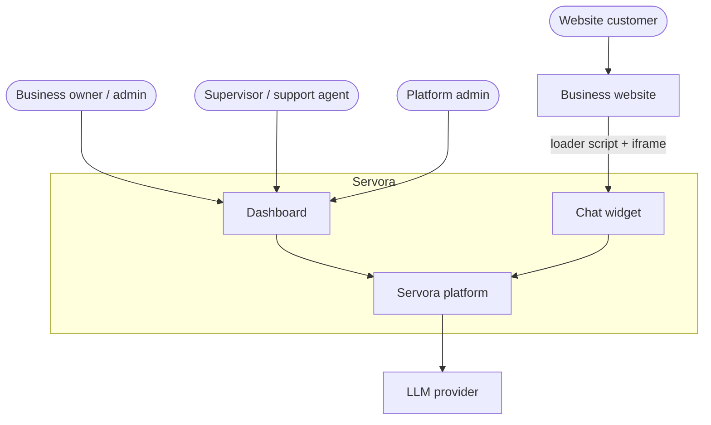
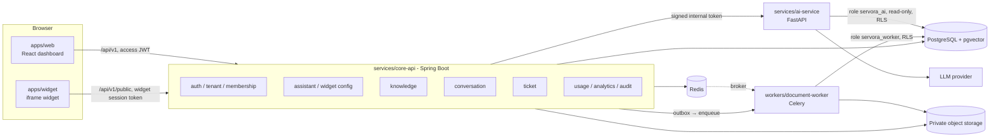

# System overview

Servora is a Spring Boot modular monolith with a separate Python AI service and an asynchronous document worker. Decisions behind this shape are in the [ADRs](adr/README.md).

## System context

## Components

## Responsibilities

| Component | Owns | Must not own |
|---|---|---|
| React dashboard | Workspace UI, agent interface, admin configuration | Authorization decisions, secrets, tenant trust |
| Widget iframe | Customer chat UI, use of a scoped session token | Administrative APIs, service credentials |
| Core API | Identity, membership, roles, configuration, conversations, messages, tickets, usage, audit, AI orchestration and validation of AI responses | LLM internals |
| AI service | Query embeddings, tenant-filtered retrieval, prompt assembly, provider adapter, structured output, evaluation | Membership, permissions, ticket or conversation state |
| Document worker | Extraction, normalisation, chunking, embedding, indexing, retry state | Public API authorization |
| PostgreSQL | Transactional state, tenant records, vector chunks | Unscoped cross-tenant queries |
| Redis | Job broker, rate-limit counters, cache | Durable source-of-truth records |

## Request flows

### Dashboard API request

1. Validate the access token and identify the user.
2. Read the requested workspace ID from the route. It is a selector, not proof of access.
3. Open a transaction, then check active membership in that workspace and the required role.
4. Set `app.tenant_id` transaction-locally.
5. Run tenant-scoped repository operations. RLS catches a query that misses its tenant predicate.
6. Commit or roll back. The connection returns to the pool with no tenant context.

### Customer question

1. The widget exchanges its public key for a short-lived session token. The core API resolves the key server-side and checks the widget state and the request origin.
2. The customer sends a message. The core API validates the token, applies rate limits and stores the message.
3. If the conversation is `AI_ACTIVE`, the core API calls the AI service with a signed internal token carrying the validated tenant and conversation.
4. The AI service embeds the question, retrieves active chunks for that tenant only, applies the evidence gate and asks the model for structured output.
5. Citations are verified against the retrieved chunk IDs.
6. The core API re-reads the conversation in a transaction. If the mode is still `AI_ACTIVE` and the version is unchanged, the answer is persisted and delivered. Otherwise it is suppressed and an event is recorded.

### Document ingestion

1. An admin uploads a file. The core API validates extension, sniffed content type and size, stores the file under a generated key, and writes the document row and an outbox event in one transaction.
2. The dispatcher delivers the event to the Python enqueue endpoint, which schedules the Celery task.
3. The worker extracts, normalises, chunks and embeds the text, then writes the chunks and marks the document `READY` in one transaction.
4. Replacing or deleting a document deactivates its old chunks so they cannot be retrieved.

## Conversation control modes

| Mode | AI may send an automated reply? |
|---|---|
| `AI_ACTIVE` | Yes, after the final state re-check |
| `ESCALATION_PENDING` | No |
| `HUMAN_ACTIVE` | No; AI may only draft suggestions for the agent |
| `WAITING_FOR_CUSTOMER` | No, unless policy explicitly returns the conversation to AI |
| `RESOLVED` | No |
| `CLOSED` | No |

Conversation control mode is separate from ticket status (`OPEN`, `IN_PROGRESS`, `WAITING_FOR_CUSTOMER`, `RESOLVED`, `CLOSED`).

## Local development plan

| Milestone | Services added to `docker-compose.yml` |
|---|---|
| M0 | `postgres`, `redis` |
| M1 | None. The core API and dashboard run on the host; email links are written to the development log |
| M2 | `storage` (S3-compatible emulator), `worker-api` (enqueue endpoint), `document-worker` (Celery) |
| M3 | `ai-service` |
| M4 | `widget` assets and two static demo sites |
| M7 | `core-api` and `web` containers; production profile with no public database or Redis ports, non-root users, resource limits |

The core API and dashboard run directly on the host (`mvnw spring-boot:run`, `npm run dev`) against the Compose infrastructure. See the [README](../../README.md).
