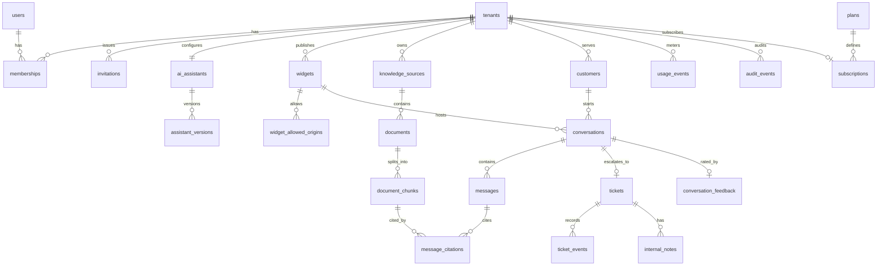

# Database design and tenant ownership

Tables marked M1 and M2 exist and are described as built. Later tables are still the plan. Migrations in `services/core-api/src/main/resources/db/migration` are the source of truth.

## Entity relationships



## Table ownership

| Table | Scope | Introduced | Notes |
|---|---|---|---|
| `users` | Global | M1 | Normalised unique email, password hash, status. Reachable from a tenant only through `memberships` |
| `platform_admins` | Global | M1 | Platform role, kept apart from workspace roles |
| `refresh_tokens` | Global (per user) | M1 | Stored hashed; rotation family for reuse detection |
| `email_verification_tokens` | Global (per user) | M1 | Stored hashed; single use; expires |
| `tenants` | Tenant root | M1 | Unique slug, status, timezone, default language, industry, logo URL, plan code. Under RLS, keyed on its own `id` |
| `plans` | Global | M6 | Plan catalogue and limits |
| `memberships` | Tenant | M1 | Unique `(tenant_id, user_id)`; role and status |
| `invitations` | Tenant | M1 | Hashed token, expiry, status; one pending invitation per email per tenant; inviter referenced by `(tenant_id, membership_id)` |
| `audit_events` | Tenant | M1 | Append-only: the runtime role has `SELECT` and `INSERT` only |
| `ai_assistants` | Tenant | M2 | One per workspace for the MVP (unique on `tenant_id`). Name, messages, language, tone, automation flag, confidence policy, current version |
| `assistant_versions` | Tenant | M2 | Immutable JSON snapshots: the runtime role has `SELECT` and `INSERT` only |
| `widgets` | Tenant | M2 | One per workspace for the MVP. Globally unique public key, which is an identifier, not a secret |
| `widget_allowed_origins` | Tenant | M2 | Canonical origin, exact matching, format enforced by a check constraint. Replaced as a whole list |
| `knowledge_sources` | Tenant | M2 | One default "Uploaded documents" source per workspace |
| `documents` | Tenant | M2 | One row per version; versions share a `lineage_id`. Generated storage key, content hash, status, safe error code, chunk count |
| `document_chunks` | Tenant | M2 | Text, page and heading metadata, unconstrained `vector` embedding, model id/revision/dimension (checked against the vector), active flag |
| `outbox_events` | Tenant | M2 | Written with the change it describes; delivered by the dispatcher ([ADR-016](../architecture/adr/0016-outbox-dispatcher-reads-across-tenants.md)) |
| `customers` | Tenant | M4 | Anonymous visitor: widget, created and last-seen times. No name, email or IP address |
| `conversations` | Tenant | M4 | Status (`OPEN`, `CLOSED`), control mode (`AI_ACTIVE`, `HUMAN_PENDING`, `HUMAN_ACTIVE`), `version` bumped on every status or mode change, the checked origin, handoff time. Assignment arrives in M5 |
| `ai_interactions` | Tenant | M3 | Append-only. One row per question put to the assistant: outcome, retrieved chunk ids and scores, cited chunk ids, provider, model, prompt version, latency and token usage |
| `messages` | Tenant | M4 | Append-only. Sender type, visibility (`PUBLIC`, `INTERNAL`), delivery status (`DELIVERED`, `SUPPRESSED`, which must be internal), unique idempotency key per conversation, the customer message a reply answers, and the `ai_interactions` row holding model metadata and token usage |
| `message_citations` | Tenant | M4 | Append-only snapshot of what was cited: chunk and document ids, filename, page, heading, snippet. No foreign key to the chunk, so the record survives re-indexing and deletion |
| `tickets` | Tenant | M5 | One per escalated conversation. Per-workspace number, unique idempotency key, status, priority, reason, assignee, outcome, first response and resolution times |
| `ticket_events` | Tenant | M5 | Append-only. Created, assigned, status and priority changes, takeover, resolution, closure, with the actor |
| `internal_notes` | Tenant | M5 | Append-only, in their own table so no customer-facing query can return one |
| `conversation_feedback` | Tenant | M5 | One rating (1 to 5) and optional comment per conversation, after resolution |
| `notification_events` | Tenant | M5 | Per recipient: ticket assigned, customer message. Only `read_at` can change |
| `usage_events` | Tenant | M6 | Append-only |
| `subscriptions` | Tenant | M6 | |

## Rules for every tenant-scoped table

1. `tenant_id UUID NOT NULL`.
2. `UNIQUE (tenant_id, id)` so children can reference the parent within the same tenant.
3. Child foreign keys include the tenant: `FOREIGN KEY (tenant_id, conversation_id) REFERENCES conversations (tenant_id, id)`.
4. Row-Level Security enabled and forced, with a policy for both reads and writes:

```sql
ALTER TABLE conversations ENABLE ROW LEVEL SECURITY;
ALTER TABLE conversations FORCE ROW LEVEL SECURITY;

CREATE POLICY tenant_isolation_conversations ON conversations
  USING (tenant_id = NULLIF(current_setting('app.tenant_id', true), '')::uuid)
  WITH CHECK (tenant_id = NULLIF(current_setting('app.tenant_id', true), '')::uuid);
```

With no tenant context the setting is empty, the comparison is against `NULL`, and no rows are visible.

Tenant context is set inside the authorised transaction, never at session scope:

```sql
SELECT set_config('app.tenant_id', :validatedTenantId, true);
```

## Document states

| State | Meaning | Next |
|---|---|---|
| `UPLOADED` | Stored privately; not yet handed to the worker | `QUEUED`, `PROCESSING`, `FAILED`, `DELETED` |
| `QUEUED` | The worker has accepted the job | `PROCESSING`, `DELETED` |
| `PROCESSING` | Extraction, chunking, embedding and indexing in progress | `READY`, `FAILED`, `DELETED` |
| `READY` | Indexed; its active chunks are eligible for retrieval | `ARCHIVED`, `UPLOADED` (reprocess), `DELETED` |
| `FAILED` | Processing failed; a safe error code is recorded | `UPLOADED` (retry), `ARCHIVED`, `DELETED` |
| `ARCHIVED` | Kept, but all its chunks are inactive | `UPLOADED` (restore), `DELETED` |
| `DELETED` | Chunks removed, stored file removed through the outbox; only metadata remains | — |

A document becomes `READY` only in the transaction that writes its chunks. In that same transaction, older versions of the same lineage are archived and their chunks deactivated, so retrieval never sees two versions or none.

## Database roles

| Role | Used by | Privileges |
|---|---|---|
| `servora_owner` | Flyway migrations | Owns all objects. Not used at runtime |
| `servora_app` | Core API runtime | DML on application tables. Does not own tables, no `BYPASSRLS` |
| `servora_ai` | AI service | Read-only. `SELECT` on `document_chunks` and on four columns of `documents` (`id`, `tenant_id`, `original_filename`, `status`). Nothing else |
| `servora_worker` | Document worker | `SELECT` on `documents`; `UPDATE` on its processing columns only (`status`, `error_code`, `chunk_count`, `processed_at`, `updated_at`); `SELECT`, `INSERT`, `DELETE` and `UPDATE (active)` on `document_chunks`. Nothing else |

`servora_owner` is created by the Compose environment; `servora_app`, `servora_worker` and `servora_ai` by `infrastructure/database/init` when the volume is first initialised. The runtime role has no `DELETE` privilege on any tenant-owned table.

## Global tables and lookups without tenant context

Some lookups happen before a tenant is known. As built in M1 ([ADR-015](../architecture/adr/0015-row-level-security-context-beyond-the-tenant-id.md)):

| Lookup | How it works |
|---|---|
| Login by email | `users` is a global table, not under RLS |
| Validating membership; listing a user's workspaces | Policies also expose rows matching the transaction-local `app.user_id` |
| Accepting an invitation by token | A policy exposes the one row matching the transaction-local `app.invitation_token_hash` |
| Outbox dispatch (background job, no tenant) | A policy exposes `outbox_events` rows when the transaction-local `app.outbox_dispatcher` is on ([ADR-016](../architecture/adr/0016-outbox-dispatcher-reads-across-tenants.md)) |

These settings unlock reads only; every write policy requires `app.tenant_id`. Resolving a widget public key is designed in M4.

## Indexes

Start with indexes that match known query patterns: `(tenant_id, status)`, `(tenant_id, created_at)`, `(tenant_id, conversation_id)`. Vector search starts as an exact scan with tenant filters; approximate indexes wait for a benchmark ([ADR-003](../architecture/adr/0003-postgresql-with-pgvector-as-the-single-database.md)).
