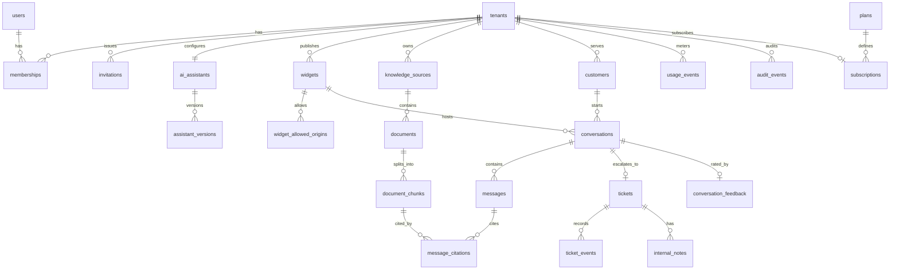

# Database design and tenant ownership

This is the M0 draft. Column lists are the planned minimum; migrations written in each milestone are the source of truth and this document is updated with them.

## Entity relationships



## Table ownership

| Table | Scope | Introduced | Notes |
|---|---|---|---|
| `users` | Global | M1 | Normalised unique email, password hash, status. Reachable from a tenant only through `memberships` |
| `platform_admins` | Global | M1 | Platform role, kept apart from workspace roles |
| `refresh_tokens` | Global (per user) | M1 | Stored hashed; rotation family for reuse detection |
| `tenants` | Global root | M1 | Unique slug, status, timezone, default language, plan reference |
| `plans` | Global | M6 | Plan catalogue and limits |
| `memberships` | Tenant | M1 | Unique `(tenant_id, user_id)`; role and status |
| `invitations` | Tenant | M1 | Hashed token, expiry, status |
| `audit_events` | Tenant | M1 | Append-only |
| `ai_assistants` | Tenant | M2 | One per workspace for the MVP |
| `assistant_versions` | Tenant | M2 | Immutable configuration snapshots |
| `widgets` | Tenant | M2 | Public key is an identifier, not a secret |
| `widget_allowed_origins` | Tenant | M2 | Normalised origin, exact matching |
| `knowledge_sources` | Tenant | M2 | |
| `documents` | Tenant | M2 | Generated storage key, content hash, version, processing status, safe error code |
| `document_chunks` | Tenant | M2 | Text, page/heading metadata, `vector` embedding, model id/revision/dimension, active flag |
| `outbox_events` | Tenant | M2 | Reliable dispatch to the worker |
| `customers` | Tenant | M4 | Pseudonymous identity; optional name and email under privacy rules |
| `conversations` | Tenant | M4 | Status, control mode, assigned agent, `version` for optimistic locking |
| `messages` | Tenant | M4 | Sender type, visibility, delivery status, model metadata, token usage |
| `message_citations` | Tenant | M4 | References chunks that were actually retrieved |
| `tickets` | Tenant | M5 | One per escalated conversation for the MVP; unique idempotency key |
| `ticket_events` | Tenant | M5 | Append-only |
| `internal_notes` | Tenant | M5 | Never returned by public endpoints |
| `conversation_feedback` | Tenant | M5 | |
| `notification_events` | Tenant | M5 | |
| `usage_events` | Tenant | M6 | Append-only |
| `subscriptions` | Tenant | M6 | |

## Rules for every tenant-scoped table

1. `tenant_id UUID NOT NULL`.
2. `UNIQUE (tenant_id, id)` so children can reference the parent within the same tenant.
3. Child foreign keys include the tenant: `FOREIGN KEY (tenant_id, conversation_id) REFERENCES conversations (tenant_id, id)`.
4. Row-Level Security enabled and forced, with a policy for both reads and writes:

```sql
ALTER TABLE conversations ENABLE ROW LEVEL SECURITY;
ALTER TABLE conversations FORCE ROW LEVEL SECURITY;

CREATE POLICY tenant_isolation_conversations ON conversations
  USING (tenant_id = NULLIF(current_setting('app.tenant_id', true), '')::uuid)
  WITH CHECK (tenant_id = NULLIF(current_setting('app.tenant_id', true), '')::uuid);
```

With no tenant context the setting is empty, the comparison is against `NULL`, and no rows are visible.

Tenant context is set inside the authorised transaction, never at session scope:

```sql
SELECT set_config('app.tenant_id', :validatedTenantId, true);
```

## Database roles

| Role | Used by | Privileges |
|---|---|---|
| `servora_owner` | Flyway migrations | Owns all objects. Not used at runtime |
| `servora_app` | Core API runtime | DML on application tables. Does not own tables, no `BYPASSRLS` |
| `servora_ai` | AI service | `SELECT` on the knowledge tables needed for retrieval |
| `servora_worker` | Document worker | Insert chunks; update document processing state |

In M0 only `servora_owner` exists, created by the Compose environment. The other roles are created in the milestone that first uses them.

## Global tables and lookups without tenant context

Some lookups happen before a tenant is known: login by email, listing a user's workspaces, accepting an invitation by token, and resolving a widget public key. These are handled by narrowly scoped queries or `SECURITY DEFINER` functions that return only the minimum needed to establish context. Each one is designed and tested in the milestone that introduces it, and listed here.

## Indexes

Start with indexes that match known query patterns: `(tenant_id, status)`, `(tenant_id, created_at)`, `(tenant_id, conversation_id)`. Vector search starts as an exact scan with tenant filters; approximate indexes wait for a benchmark ([ADR-003](../architecture/adr/0003-postgresql-with-pgvector-as-the-single-database.md)).
